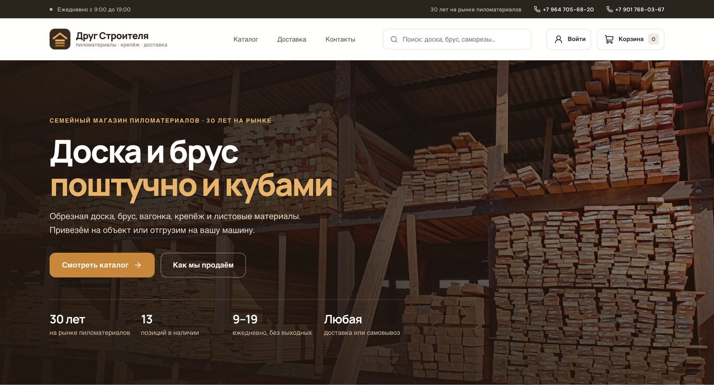
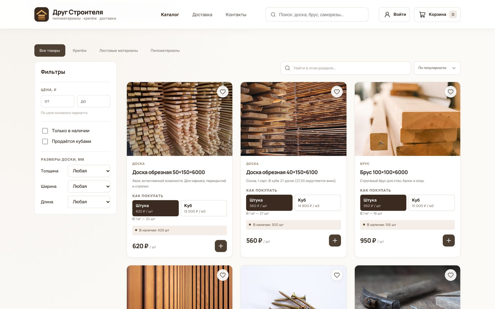
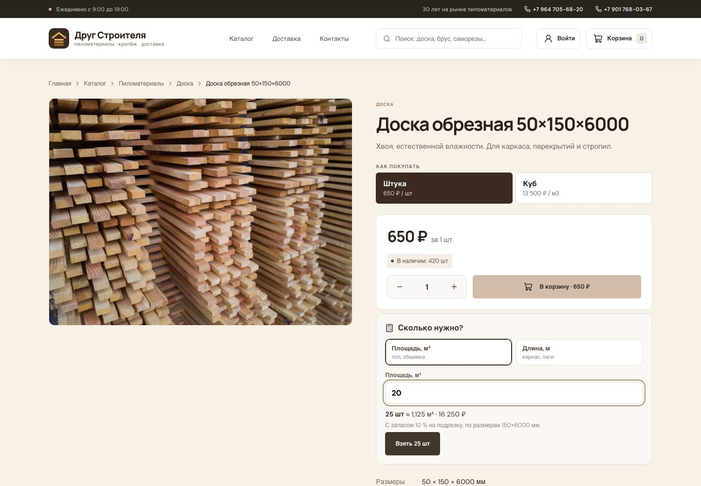
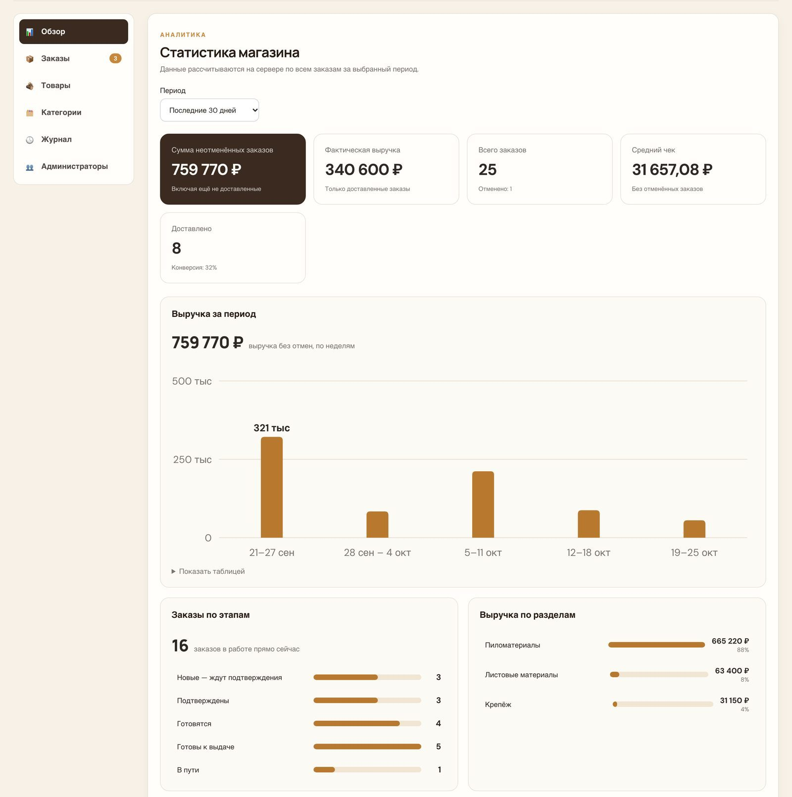
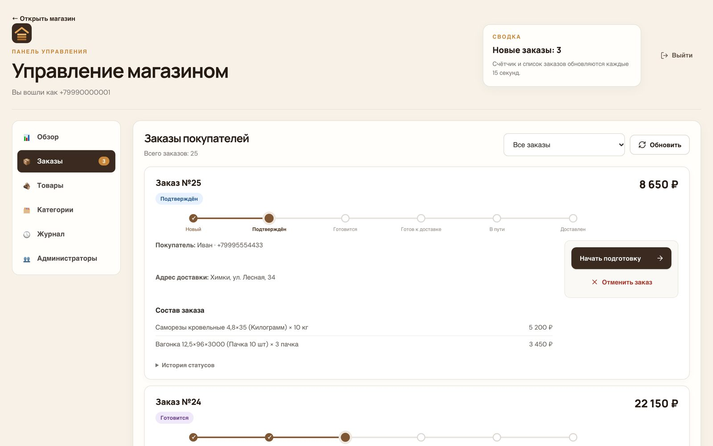
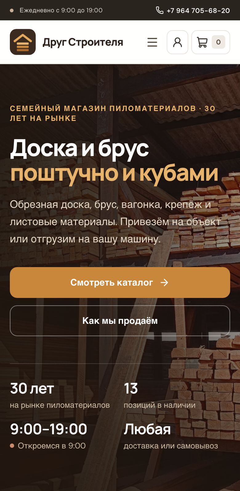
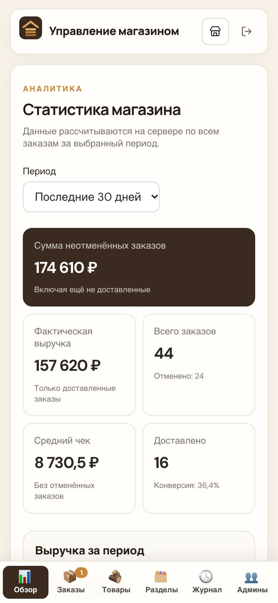
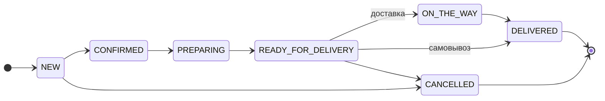
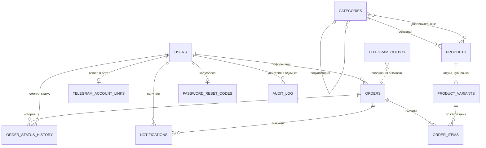

<p align="center">
  
</p>

<h1 align="center">Друг Строителя</h1>

<p align="center">
  Интернет-магазин пиломатериалов и крепежа для семейного бизнеса:<br />
  сайт, админ-панель и Telegram-бот с уведомлениями о заказах.
</p>

<p align="center">
  <a href="https://github.com/haz2007/-Builder-s-Friend-/actions/workflows/ci.yml"></a>
  
  
  
  
  
</p>

---

<p align="center">
  
</p>

## Возможности

**Магазин**
- Каталог с разделами и подкатегориями (Пиломатериалы → Доска, Брус, Вагонка), поиск и фильтры: цена, наличие, размеры доски
- Варианты продажи одного товара: **поштучно, кубами, пачкой, коробкой**. Склад общий и хранится в базовой единице: для доски с размерами 40×150×6100 в 1 м³ помещается 27,33 доски → продаётся 27 штук
- Корзина, оформление заказа с **доставкой или самовывозом** и комментарием («распилить по 3 м»)
- Личный кабинет `/account`: заказы со статусами, избранное, уведомления, смена пароля и удаление аккаунта
- **Заказ без регистрации**: «Перезвоните мне» — имя, телефон и корзина уходят менеджеру в Telegram
- Калькулятор материала: сколько досок нужно на площадь пола или длину каркаса, с запасом 10 %
- Восстановление пароля кодом из Telegram-бота и смена пароля в личном кабинете; страницы «Доставка и возврат», согласие и политика
- Поиск по ключевым словам: «доски 50х150» находит «Доска обрезная 50×150×6000»; при опечатке («досака») — «Возможно, вы искали» на `pg_trgm`
- Карта склада с маршрутом в Яндекс Картах, 2ГИС и Google Maps
- SEO без серверного рендеринга: Caddy вставляет в `<head>` заголовок, описание и разметку schema.org (магазин, товар с ценой) для каждой страницы; карта сайта `/sitemap.xml`
- Красивое превью ссылки в Telegram, WhatsApp и VK; политика конфиденциальности и согласие при регистрации (152-ФЗ)

**Админ-панель** (`/admin`)
- Аналитика на SQL: выручка по дням / неделям / месяцам, заказы по этапам, выручка по разделам,
  ABC-анализ товаров, сводка по месяцам с ростом к прошлому, повторные покупки
- Заказы: только допустимые действия — следующий этап или отмена; отмена возвращает товар на склад.
  У самовывоза свой путь: «Готов к выдаче» → «Выдан», без этапа «В пути»
- Журнал действий: кто и когда менял статус заказа, цены, остатки, категории, админов
- Сброс пароля покупателю — временный пароль, если не подключён Telegram-бот
- Печать бланка заказа для водителя или покупателя: реквизиты продавца, позиции, подписи
- Выгрузка заказов в Excel для учёта: лист заказов с итогом и лист проданных позиций
- Заявки «перезвоните мне» с отметкой «Перезвонили»; админка удобна с телефона
- Фото товара сжимается в WebP до 1600 px, поворот по EXIF исправляется, GPS из снимка удаляется
- Товары, варианты продажи, размеры досок, фото, категории и подкатегории
- Роли: владелец назначает и снимает администраторов

**Telegram-бот**
- Покупатель: заказы, отмена нового заказа, уведомления о статусах, каталог, контакты
- Администратор: заказы с фильтрами и кнопками смены статуса, сводка, низкие остатки
- Склад с телефона: найти товар и изменить остаток («+20» — приход, «-3» — списание, «150» — пересчёт) или цену; правки попадают в журнал
- Новый товар с фото прямо из бота: сфотографировал на складе — отправил; раздел «📞 Заявки» по 5 штук с кнопкой «Перезвонили»
- После доставки — просьба оставить отзыв на Яндекс Картах
- Уведомления приходят только тем, кто вошёл в бота

**Надёжность и безопасность**
- Параллельные заказы не продают больше, чем есть: блокировка строк товаров в одном порядке, без deadlock
- Ограничение частоты: вход, регистрация, заказы и вход в бота — защита от подбора пароля и спама
- Пароль от 8 символов, CHECK-ограничения в базе: остаток не уйдёт в минус, статус и роль — только из списка
- Ежедневные бэкапы базы и фото, восстановление одной командой
- Уведомления не теряются: transactional outbox с повторами и `FOR UPDATE SKIP LOCKED`
- Мониторинг: при поломке сервер сам пишет владельцу в Telegram
- Если с сервера закрыт Telegram — бот работает через бесплатного посредника на Cloudflare Workers

## Скриншоты

| Каталог | Карточка товара |
|---|---|
|  |  |
| **Админка: аналитика** | **Админка: заказы** |
|  |  |

<p align="center">
  
  &nbsp;&nbsp;
  
</p>

## Стек

| | |
|---|---|
| Backend | Python 3.13, FastAPI, SQLAlchemy 2 (типизированные модели), Alembic, PostgreSQL, JWT |
| Frontend | React 19, TypeScript, Vite, React Router |
| Бот | Telegram Bot API (long polling) |
| Качество | pytest — 222 теста (API, бизнес-логика, SQL-отчёты, бот, параллельные заказы, защита); Vitest для фронтенда; E2E на Playwright: покупка, корзина, заявка без регистрации, кабинет и удаление аккаунта, обработка заказа; ruff, mypy, oxlint; CI на GitHub Actions |
| Деплой | Docker Compose, Caddy (автоматический HTTPS), сервер от 1 ГБ памяти |

## Документация

| Документ | Что внутри |
|---|---|
| [Бизнес-правила](docs/business-rules.md) | 38 пронумерованных правил: склад и кубы, заказы и статусы, уведомления, роли |
| [Диаграммы](docs/diagrams.md) | архитектура, ER-модель, жизненный цикл заказа, последовательности, расчёт склада, варианты использования, C4, защита (Mermaid) |
| [Крайние случаи](docs/edge-cases.md) | параллельные заказы, округления, сбои Telegram, известные ограничения |
| [SQL](docs/sql/README.md) | отчёты на CTE и оконных функциях (ABC-анализ, рост к прошлому месяцу), индексы с замерами на 200 000 заказов, NUMERIC для денег |
| [OpenAPI](docs/api/openapi.json) | спецификация API; Swagger UI — `/docs` на запущенном backend |



<sub>Жизненный цикл заказа (упрощённо): доставка идёт через «В пути», самовывоз из «Готов к выдаче» сразу становится «Выдан». Отмена возможна со всех этапов до «В пути» — см. диаграммы.</sub>

### Связи таблиц



<sub>Поля таблиц и ограничения — в [полной ER-диаграмме](docs/diagrams.md#2-модель-данных).</sub>

## Структура

```
backend/
  app/
    routers/        # REST API: товары, заказы, категории, админка, админы
    services/       # бизнес-логика: статусы заказов, варианты, уведомления
    models.py       # SQLAlchemy-модели
    sql/            # отчёты на чистом SQL: CTE, оконные функции
    store_info.py   # контакты магазина для бота
  alembic/          # миграции БД
  bot/              # Telegram-бот по модулям: вход, каталог, покупатель, админ, владелец
  run_telegram_bot.py  # точка входа бота
  seed_demo.py      # пробные товары с вариантами продажи
  manage.py         # служебные команды (миграции, владелец, OpenAPI)
  benchmarks/       # замер индексов на 200 000 заказов
frontend/src/
  pages/            # главная, каталог, страница товара
  components/       # карточка товара, выбор варианта, карта, логотип
  shop/             # общий контекст магазина, контакты, форматирование
  Admin.tsx         # админ-панель: вход и меню; разделы — *Section.tsx
frontend/e2e/       # Playwright: покупатель оформляет заказ, админ подтверждает
tests/              # pytest
docs/               # бизнес-правила, диаграммы, крайние случаи, OpenAPI
scripts/            # настройка сервера, бэкап и восстановление
deploy/             # посредник Telegram на Cloudflare Workers (если Telegram закрыт)
.github/workflows/  # CI: тесты, линтер, сборка Docker
```

## Запуск локально

**1. База данных** (PostgreSQL в Docker на порту 5110)
```bash
docker compose up -d
```

**2. Backend**
```bash
cd backend
python3 -m venv .venv && source .venv/bin/activate
pip install -r requirements.txt
cp .env.example .env            # заполни SECRET_KEY, при желании TELEGRAM_BOT_TOKEN
python manage.py init-db        # новая база: таблицы + отметка миграций
python seed_demo.py             # пробные товары
python manage.py set-owner <email или телефон>   # владелец магазина
uvicorn app.main:app --reload
```

**3. Frontend**
```bash
cd frontend
npm install
npm run dev                     # http://localhost:5173, админка — /admin
```

**4. Telegram-бот** (нужен `TELEGRAM_BOT_TOKEN` в `backend/.env`)
```bash
cd backend && python run_telegram_bot.py
```

Для уже существующей базы обновления схемы применяются обычно: `alembic upgrade head`.

## Деплой

Сайт, API, бот и база запускаются одной командой через Docker Compose с автоматическим HTTPS (Caddy) — см. [DEPLOY.md](DEPLOY.md).
Скрипт `scripts/setup-server.sh` готовит чистый Ubuntu-сервер: swap, Docker, файрвол и ежедневный бэкап.

## Тесты и проверки

Тесты используют отдельную базу `wood_commerce_test` и никогда не пишут в настоящий Telegram.
```bash
docker exec wood_commerce_db createdb -U postgres wood_commerce_test   # один раз
backend/.venv/bin/python -m pytest
```

Линтер и проверка типов (их же запускает CI):
```bash
backend/.venv/bin/pip install -r backend/requirements-dev.txt
backend/.venv/bin/ruff check .
cd backend && .venv/bin/mypy
```

Фронтенд: юнит-тесты (Vitest) и E2E (Playwright). E2E поднимает бэкенд на отдельной базе
`wood_commerce_e2e` и dev-сервер сам:
```bash
docker exec wood_commerce_db createdb -U postgres wood_commerce_e2e    # один раз
cd frontend && npm test
cd frontend && npx playwright install chromium && npm run test:e2e
```
