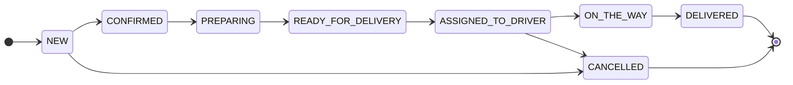

<p align="center">
  
</p>

<h1 align="center">Друг Строителя</h1>

<p align="center">
  Интернет-магазин пиломатериалов и крепежа для семейного бизнеса:<br />
  сайт, админ-панель и Telegram-бот с уведомлениями о заказах.
</p>

---

## Возможности

**Магазин**
- Каталог с разделами и подкатегориями (Пиломатериалы → Доска, Брус, Вагонка), поиск и фильтры: цена, наличие, размеры доски
- Варианты продажи одного товара: **поштучно, кубами, пачкой, коробкой**. Склад общий и хранится в базовой единице: для доски с размерами 40×150×6100 в 1 м³ помещается 27,33 доски → продаётся 27 штук
- Корзина, оформление заказа с **доставкой или самовывозом**, личный кабинет с историей и статусами
- Карта склада с маршрутом в Яндекс Картах, 2ГИС и Google Maps

**Админ-панель** (`/admin`)
- Аналитика: выручка по дням / неделям / месяцам, заказы по этапам, выручка по разделам
- Заказы: только допустимые действия — следующий этап или отмена; отмена возвращает товар на склад
- Товары, варианты продажи, размеры досок, фото, категории и подкатегории
- Роли: владелец назначает и снимает администраторов

**Telegram-бот**
- Покупатель: заказы, отмена нового заказа, уведомления о статусах, каталог, контакты
- Администратор: заказы с фильтрами и кнопками смены статуса, сводка, низкие остатки
- После доставки — просьба оставить отзыв на Яндекс Картах
- Уведомления приходят только тем, кто вошёл в бота

## Стек

| | |
|---|---|
| Backend | Python 3.13, FastAPI, SQLAlchemy 2, Alembic, PostgreSQL, JWT |
| Frontend | React 19, TypeScript, Vite, React Router |
| Бот | Telegram Bot API (long polling) |
| Тесты | pytest — 127 тестов API, бизнес-логики и параллельных заказов |

## Документация

| Документ | Что внутри |
|---|---|
| [Бизнес-правила](docs/business-rules.md) | 30 пронумерованных правил: склад и кубы, заказы и статусы, уведомления, роли |
| [Диаграммы](docs/diagrams.md) | архитектура, ER-модель, жизненный цикл заказа, последовательности, расчёт склада (Mermaid) |
| [Крайние случаи](docs/edge-cases.md) | параллельные заказы, округления, сбои Telegram, известные ограничения |
| [OpenAPI](docs/api/openapi.json) | спецификация API; Swagger UI — `/docs` на запущенном backend |



<sub>Жизненный цикл заказа (упрощённо; отмена возможна со всех этапов до «В пути» — см. диаграммы).</sub>

## Структура

```
backend/
  app/
    routers/        # REST API: товары, заказы, категории, админка, админы
    services/       # бизнес-логика: статусы заказов, варианты, уведомления
    models.py       # SQLAlchemy-модели
    store_info.py   # контакты магазина для бота
  alembic/          # миграции БД
  run_telegram_bot.py
  seed_demo.py      # пробные товары с вариантами продажи
  manage.py         # служебные команды (назначить владельца)
frontend/src/
  pages/            # главная, каталог, страница товара
  components/       # карточка товара, выбор варианта, карта, логотип
  shop/             # общий контекст магазина, контакты, форматирование
  Admin.tsx         # админ-панель
tests/              # pytest
docs/               # бизнес-правила, диаграммы, крайние случаи, OpenAPI
```

## Запуск локально

**1. База данных** (PostgreSQL в Docker на порту 5110)
```bash
docker compose up -d
```

**2. Backend**
```bash
cd backend
python3 -m venv .venv && source .venv/bin/activate
pip install -r requirements.txt
cp .env.example .env            # заполни SECRET_KEY, при желании TELEGRAM_BOT_TOKEN
python manage.py init-db        # новая база: таблицы + отметка миграций
python seed_demo.py             # пробные товары
python manage.py set-owner <email или телефон>   # владелец магазина
uvicorn app.main:app --reload
```

**3. Frontend**
```bash
cd frontend
npm install
npm run dev                     # http://localhost:5173, админка — /admin
```

**4. Telegram-бот** (нужен `TELEGRAM_BOT_TOKEN` в `backend/.env`)
```bash
cd backend && python run_telegram_bot.py
```

Для уже существующей базы обновления схемы применяются обычно: `alembic upgrade head`.

## Деплой

Сайт, API, бот и база запускаются одной командой через Docker Compose с автоматическим HTTPS (Caddy) — см. [DEPLOY.md](DEPLOY.md).

## Тесты

Тесты используют отдельную базу `wood_commerce_test` и никогда не пишут в настоящий Telegram.
```bash
docker exec wood_commerce_db createdb -U postgres wood_commerce_test   # один раз
backend/.venv/bin/python -m pytest
```
