# Диаграммы

Все диаграммы — в [Mermaid](https://mermaid.js.org): GitHub рисует их прямо на этой
странице, а исходник правится как обычный текст. Номера BR-xx ссылаются на
[бизнес-правила](business-rules.md).

## Содержание

1. [Архитектура](#1-архитектура)
2. [Модель данных](#2-модель-данных)
3. [Жизненный цикл заказа](#3-жизненный-цикл-заказа-br-16--br-19)
4. [Оформление заказа](#4-оформление-заказа-br-11--br-15-br-23)
5. [Смена статуса из Telegram](#5-смена-статуса-из-telegram-br-20--br-23-br-25)
6. [Сколько списать со склада](#6-сколько-списать-со-склада-br-03-br-05-br-14)
7. [Кто что может — варианты использования](#7-кто-что-может--варианты-использования)
8. [Контекст системы (C4, уровень 1)](#8-контекст-системы-c4-уровень-1)
9. [Защита от перегрузки и подбора пароля](#9-защита-от-перегрузки-и-подбора-пароля)
10. [Контейнеры (C4, уровень 2)](#10-контейнеры-c4-уровень-2)
11. [Компоненты backend (C4, уровень 3)](#11-компоненты-backend-c4-уровень-3)
12. [Развёртывание на сервере](#12-развёртывание-на-сервере)
13. [Бизнес-процесс: от заказа до выдачи](#13-бизнес-процесс-от-заказа-до-выдачи)
14. [Уведомления без потерь — transactional outbox](#14-уведомления-без-потерь--transactional-outbox-br-24-br-37)
15. [Заявка «Перезвоните мне»](#15-заявка-перезвоните-мне-br-42)
16. [Покупатель отменяет заказ](#16-покупатель-отменяет-заказ-br-18-br-19)

## 1. Архитектура

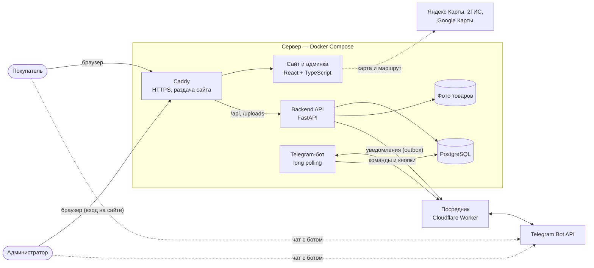

Посредник нужен, потому что с российского сервера `api.telegram.org` закрыт: запросы бота идут через Cloudflare Worker, который пропускает только наш бот (`deploy/telegram-relay-worker.js`).

## 2. Модель данных

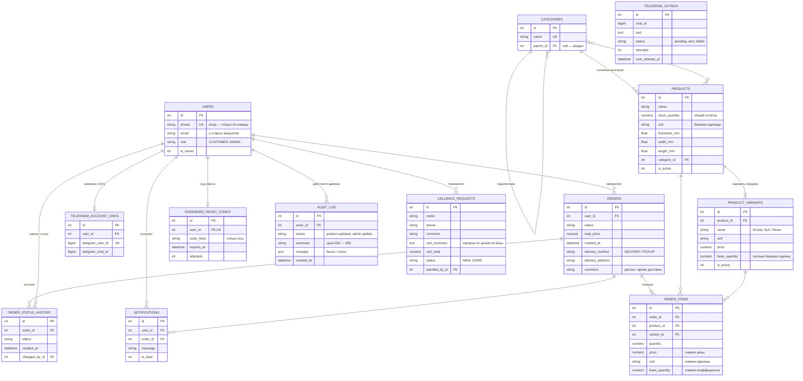

## 3. Жизненный цикл заказа (BR-16 – BR-19)

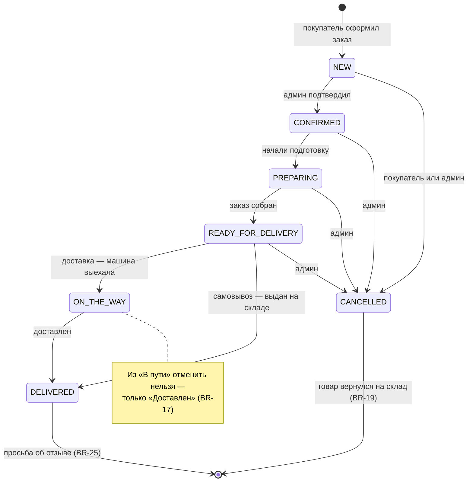

## 4. Оформление заказа (BR-11 – BR-15, BR-23)

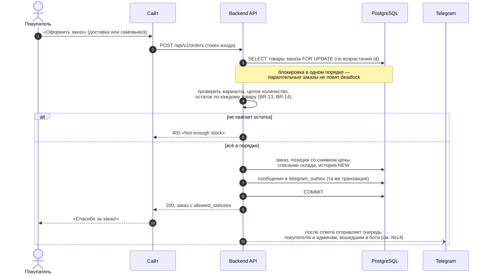

## 5. Смена статуса из Telegram (BR-20 – BR-23, BR-25)

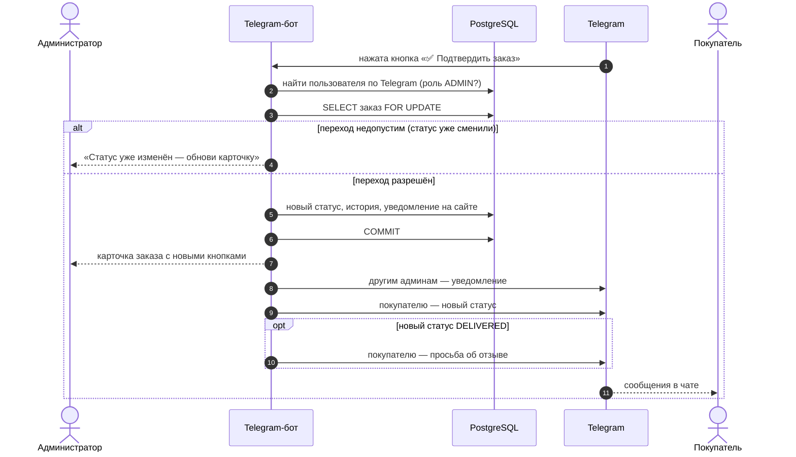

## 6. Сколько списать со склада (BR-03, BR-05, BR-14)

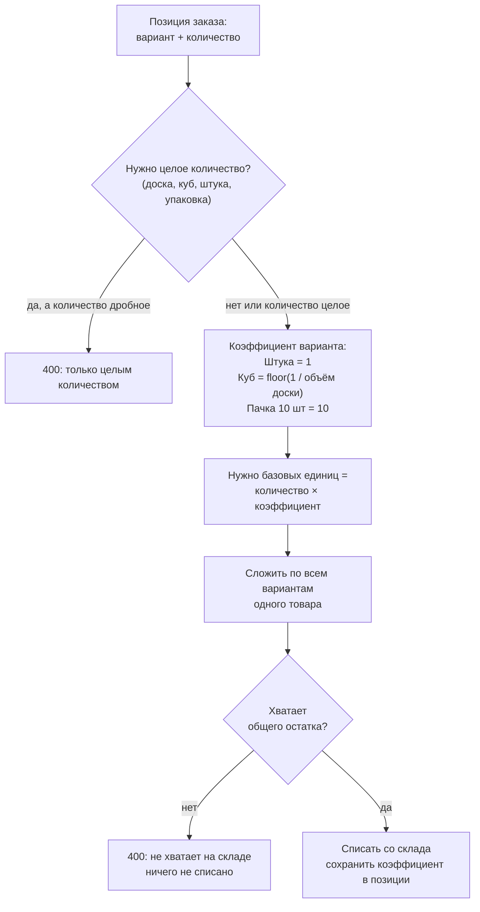

## 7. Кто что может — варианты использования

Связи «роль → действие». Владелец умеет всё, что администратор, плюс управляет
администраторами; администратор — всё, что покупатель (BR-29).

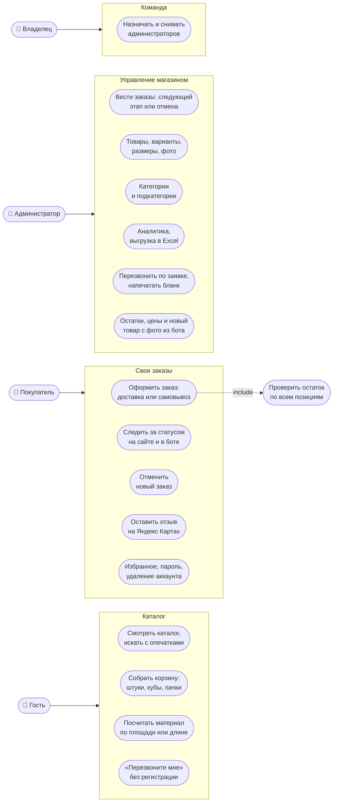

## 8. Контекст системы (C4, уровень 1)

Система целиком и всё, с чем она общается снаружи.

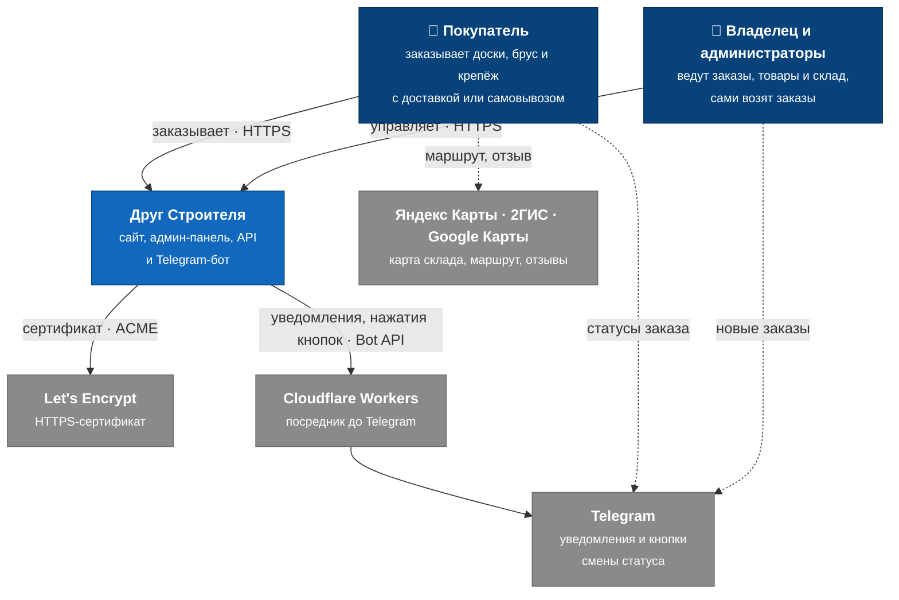

Синие — люди и наша система, серые — внешние сервисы. Устройство системы внутри — на [схеме архитектуры](#1-архитектура).

## 9. Защита от перегрузки и подбора пароля

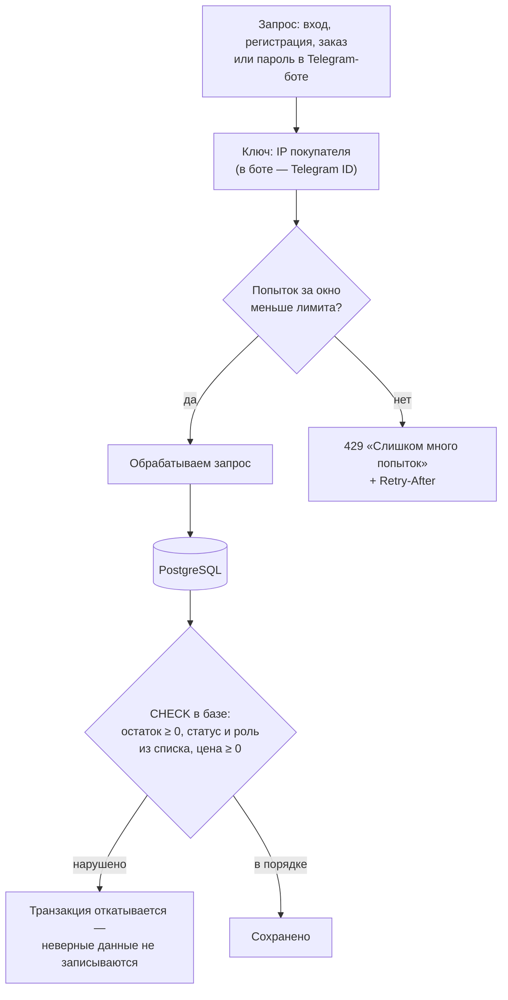

| Действие | Лимит | Ключ |
|---|---|---|
| Вход на сайте | 10 попыток за 5 минут | IP |
| Регистрация | 5 за час | IP |
| Оформление заказа | 30 за час | IP |
| Вход в Telegram-боте | 5 попыток за 10 минут | Telegram ID |
| Код сброса пароля: запросить / ввести | 3 / 10 за 15 минут | IP |
| Заявка «Перезвоните мне» | 5 за час | IP |
| Вход на сервер по SSH | 5 ошибок — бан на час (fail2ban), вход только по ключу | IP |

## 10. Контейнеры (C4, уровень 2)

Из чего состоит система «Друг Строителя» и чем контейнеры обмениваются.

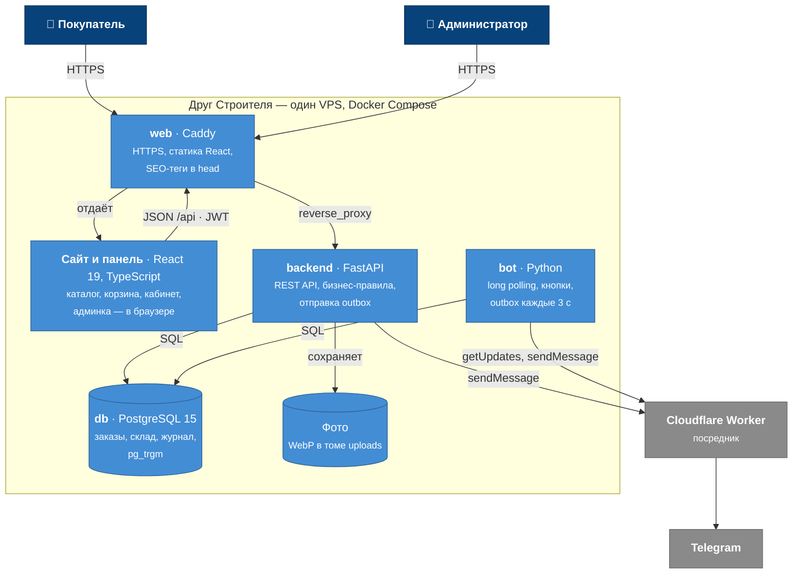

Отдельной формы входа у админки нет: администратор входит на сайте, токен тот же, а кнопка «Панель» ведёт в `/admin`.

## 11. Компоненты backend (C4, уровень 3)

Слои внутри FastAPI: роутеры принимают запрос и проверяют права, сервисы держат
бизнес-правила, модели — схему базы.

```mermaid
flowchart LR
    spa["Сайт и панель"]
    botc["Telegram-бот"]

    subgraph backend["backend · FastAPI"]
        direction TB
        subgraph routers["routers/ — HTTP"]
            r_auth["auth<br/><small>вход по телефону, регистрация,<br/>сброс и смена пароля, удаление</small>"]
            r_shop["products · categories<br/><small>каталог, поиск, подсказки,<br/>варианты, фото</small>"]
            r_orders["orders · notifications<br/><small>оформление, отмена, статусы</small>"]
            r_admin["admin · admins · users<br/><small>аналитика, журнал, Excel,<br/>роли, временный пароль</small>"]
            r_calls["callbacks<br/><small>«Перезвоните мне»</small>"]
            r_seo["seo<br/><small>head и sitemap</small>"]
        end
        subgraph services["services/ — бизнес-правила"]
            s_order["order_service<br/><small>переходы статусов, остатки</small>"]
            s_variant["variant_service<br/><small>штуки ↔ кубы</small>"]
            s_notify["order_notifications<br/><small>outbox, повторы</small>"]
            s_reports["reports · export<br/><small>SQL-отчёты, xlsx</small>"]
            s_misc["audit · images · search<br/>account · password_reset · callbacks"]
        end
        models["models.py · SQLAlchemy 2<br/><small>типизированные модели, CHECK</small>"]
    end
    db[("PostgreSQL")]

    spa --> routers
    routers --> services
    botc --> services
    services --> models
    models --> db
```

Бот не ходит в API по HTTP — он вызывает те же сервисы напрямую, поэтому правила для сайта и бота одни.

## 12. Развёртывание на сервере

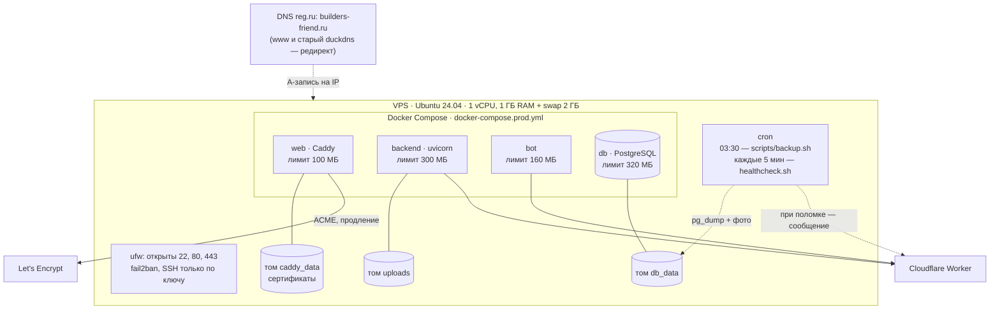

Обновление — `docker compose … up -d --build`: миграции базы применяются сами при старте backend.

## 13. Бизнес-процесс: от заказа до выдачи

Дорожки — кто выполняет шаг. Упрощённая блок-схема; тот же процесс в настоящей нотации BPMN 2.0 — [docs/bpmn/order-process.bpmn](bpmn/order-process.bpmn) (картинка — [order-process.svg](bpmn/order-process.svg)).

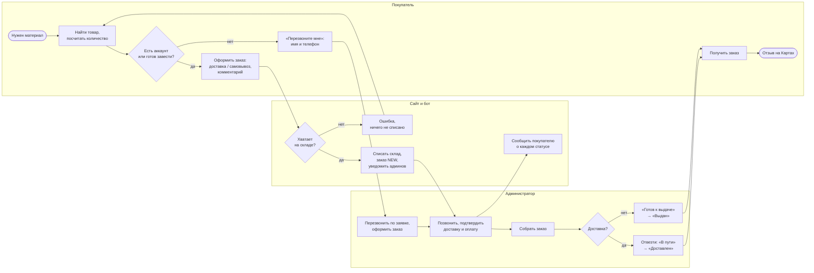

## 14. Уведомления без потерь — transactional outbox (BR-24, BR-37)

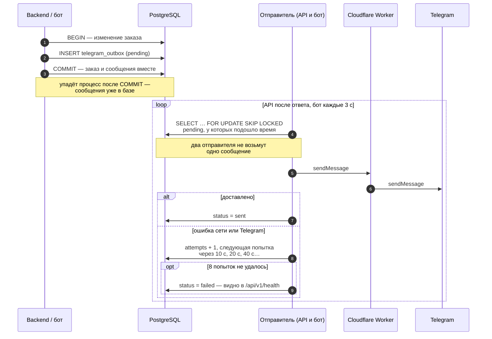

## 15. Заявка «Перезвоните мне» (BR-42)

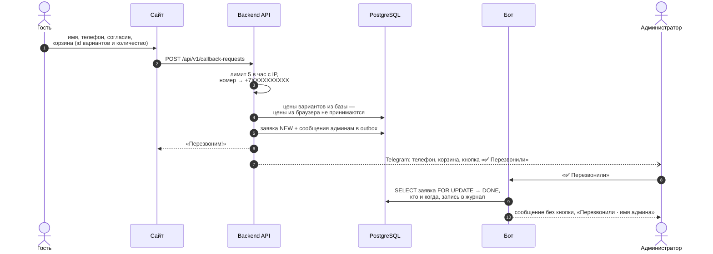

## 16. Покупатель отменяет заказ (BR-18, BR-19)

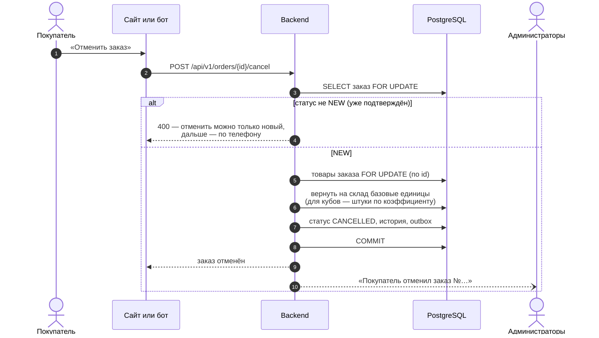
