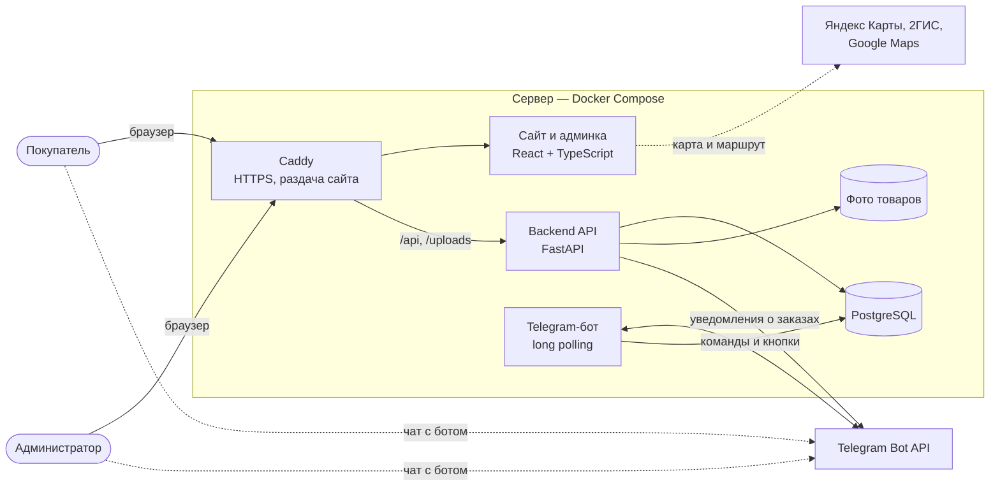
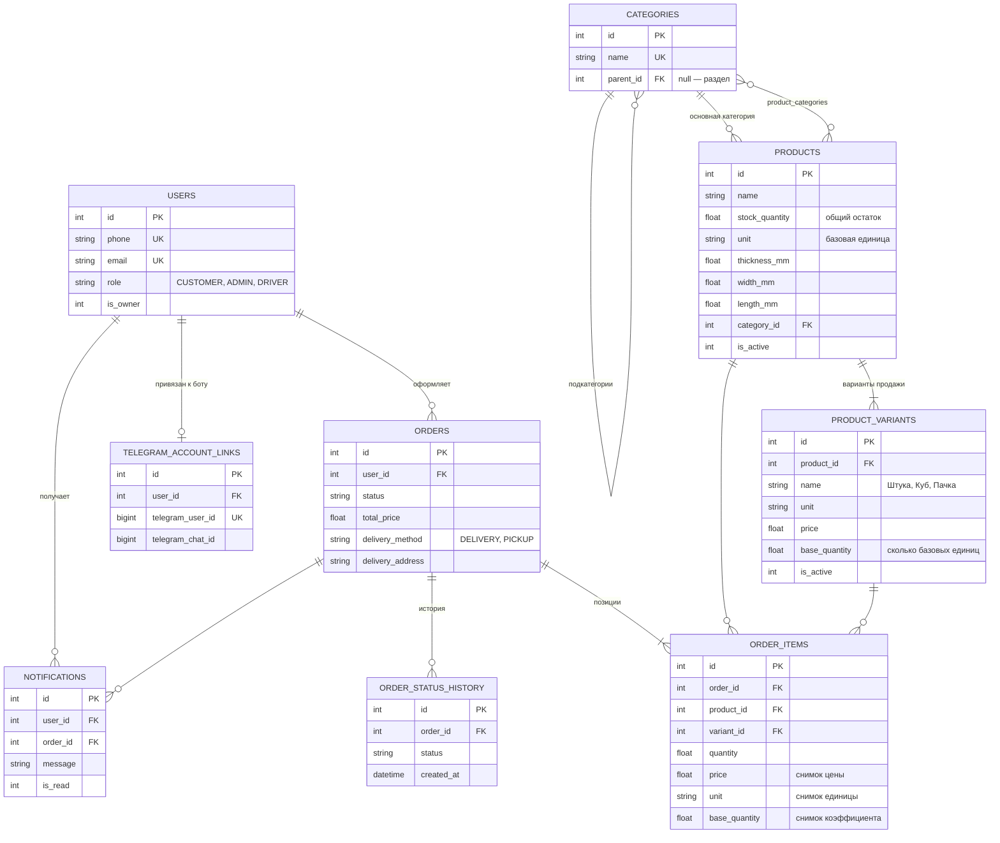
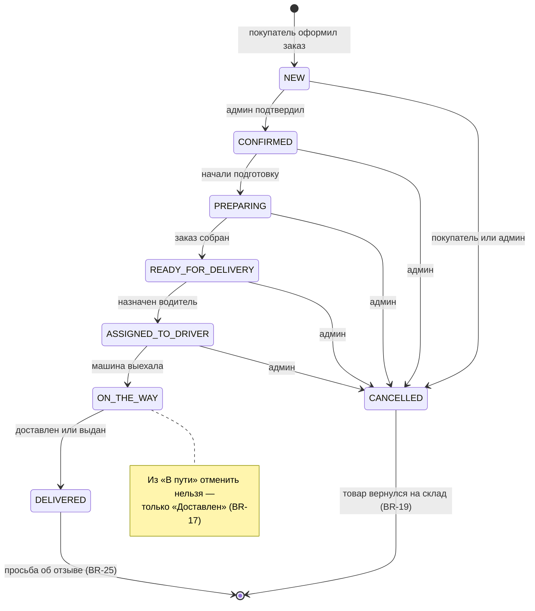
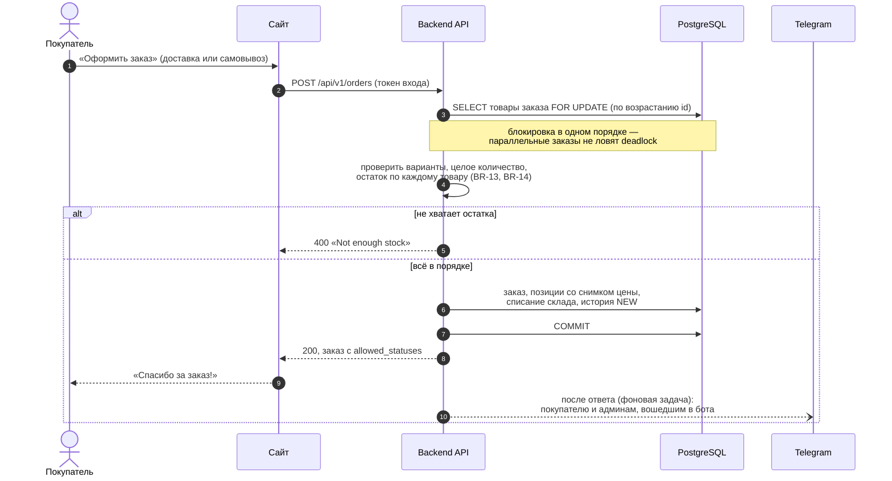
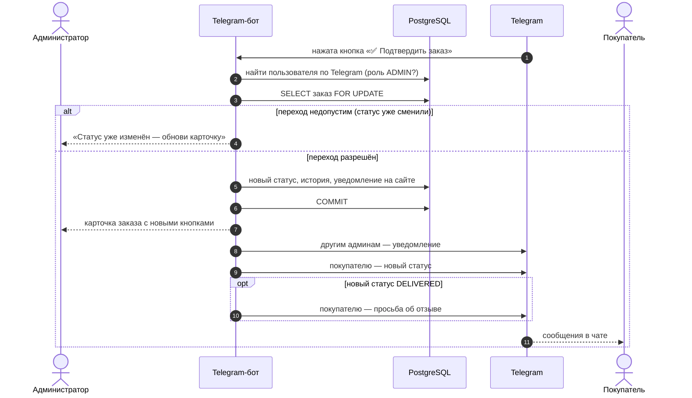
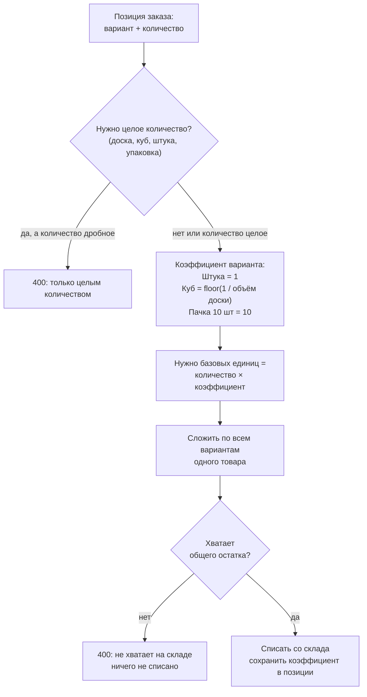

# Диаграммы

Все диаграммы — в [Mermaid](https://mermaid.js.org): GitHub рисует их прямо на этой
странице, а исходник правится как обычный текст. Номера BR-xx ссылаются на
[бизнес-правила](business-rules.md).

## 1. Архитектура

## 2. Модель данных

## 3. Жизненный цикл заказа (BR-16 – BR-19)

## 4. Оформление заказа (BR-11 – BR-15, BR-23)

## 5. Смена статуса из Telegram (BR-20 – BR-23, BR-25)

## 6. Сколько списать со склада (BR-03, BR-05, BR-14)

